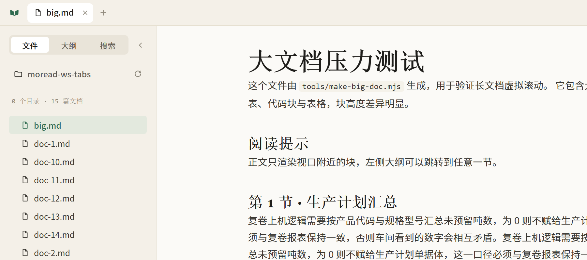
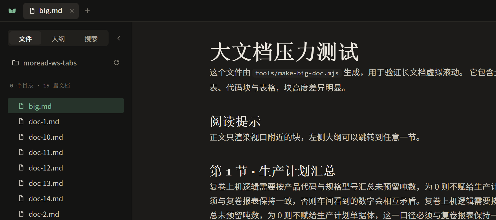
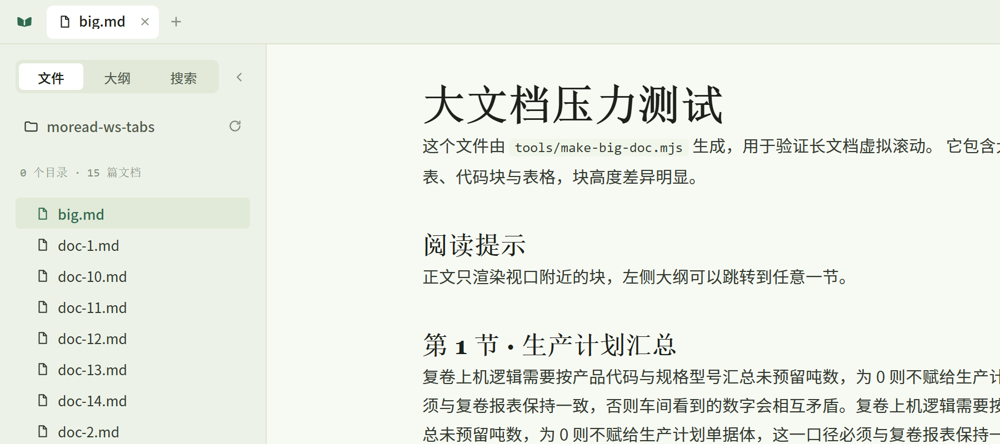
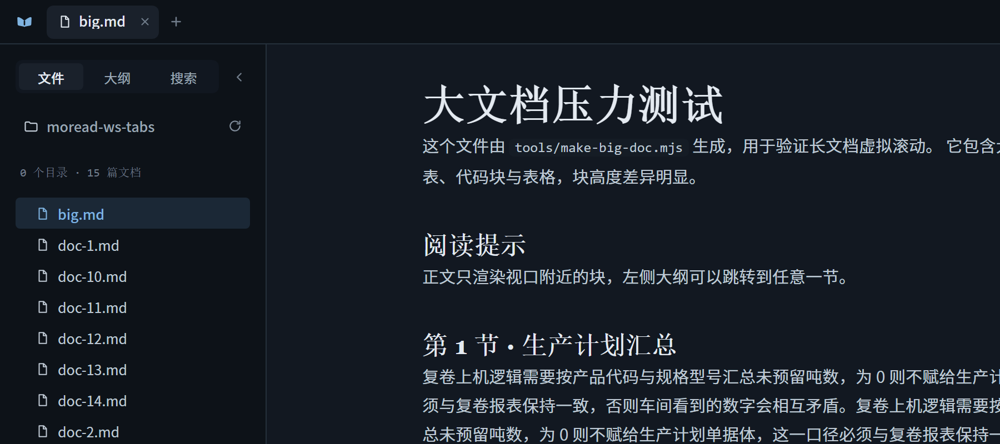

# MoRead 墨读

**Windows 上只读的 Markdown 阅读器。** 打开文件夹，读，然后关掉——它不会改动你任何一个字节。



## 为什么只读

市面上的 Markdown 编辑器都要先"进入编辑模式"，而读取一份文档时，光标、撤销栈、脏数据校验
全是多余的负担。砍掉写入之后，剩下的事可以做得更彻底：文件监视、跨文件搜索、虚拟滚动、
零干扰的排版。**没有保存按钮，也就没有"忘记保存"。**

## 现在能做什么

| 能力 | 说明 |
|---|---|
| **文件树** | 多级展开、外部改动自动重载、保留阅读位置 |
| **大纲** | 按 H1–H3 生成，滚动时高亮当前位置 |
| **跨文件搜索** | 整目录检索，命中定位到"第几次出现"，长文档也精确落点 |
| **长文档虚拟滚动** | 只渲染视口附近的块：2.5MB 文档 **60.2 fps**，全量渲染对照组 7.4 fps |
| **标签页** | 拖拽换位、固定、右键批量关闭、双击关闭；装不下时收缩 → 撤图标 → 横向滚动 → `⌄` 菜单 |
| **六套主题** | 暖纸 / 竹青 / 天青 × 浅深，全部经 WCAG 对比度审计 |
| **正文字号** | 12–22px，`Ctrl+滚轮` 直接调；只放大正文，界面像素级不动 |
| **可拖可折叠侧栏** | 200–480px，双击复位；折叠后留一条 44px 图标栏 |
| **托盘 + 文件关联** | 关窗口进托盘不退出；双击 `.md` 直接打开（免安装版不抢默认程序） |

| 暖纸 · 深 | 竹青 · 浅 | 天青 · 深 |
|---|---|---|
|  |  |  |

## 技术栈

Tauri 2（Rust 外壳 + WebView2）· Svelte 5 · Vite · TypeScript
markdown-it + DOMPurify · KaTeX · Shiki

没有前端框架生态的重依赖，安装包 **2.69 MiB**，免安装单文件 **5.05 MiB**。

## 目录

```
moread/         工程本体（源码、工具链、开发文档都在这里，细则见 moread/README.md）
outputs/
  ├─ md-reader-req-v1.md/.html   需求方案
  ├─ prototype/                  6 屏原型（S1–S6）
  ├─ design-system/              设计规范 + tokens.css / tokens.ts
  └─ app/                        实机截图与各阶段测试报告
```

## 跑起来

```bash
cd moread
npm install
npm run dev        # 开发，端口 1420
npm run preview    # 日常使用，端口 1421（无 HMR 开销，性能数据真实）
```

从源码打包（需要 Rust + MSVC + WebView2）：

```bash
cd moread
rm -rf dist && npm run tauri build     # 产物在 src-tauri/target/release/
```

Windows 下双击 `moread/启动阅读器.bat` 会自动装依赖、构建并起服务。

## 测试

不是"看起来没问题"，是每个功能都有一条能重跑的命令。全部走 Chrome DevTools Protocol 驱动真浏览器：

| 脚本 | 覆盖 | 结果 |
|---|---|---|
| `tools/e2e-check.mjs` | 文件树 / 渲染 / 外部改写自动重载 / 滚动锚点 | 8/8 |
| `tools/search-check.mjs` | 跨文件搜索与精确落点 | 13/13 |
| `tools/search-virtual.mjs` | 长文档里的深层命中定位 | 11/11 |
| `tools/tabs-check.mjs` | 标签拖拽 / 右键菜单 / 固定 / 双击关闭 | 28/28 |
| `tools/tabs-overflow-check.mjs` | 标签溢出四档兜底 | 19/19 |
| `tools/splitter-check.mjs` | 侧栏拖宽 / 折叠图标栏 / 长文档不跑位 | 33/33 |
| `tools/theme-check.mjs` | 六套主题对比度审计（纯 Node） | 6/6 |
| `tools/theme-ui-check.mjs` | 主题端到端与首帧属性 | 24/24 |
| `tools/font-check.mjs` | 字号：滚轮 / 快捷键 / 面板 / 持久化 | 29/29 |
| `cargo test` | Rust 侧命令 | 15/15 |

## 已知取舍

- 固定标签不 sticky，横向滚动时会被滚出视野（Chrome 会钉在左边）
- 桌面版拿不到 CDP，因为 WebView2 不接受 `--remote-debugging-port`，交互验证只能人工过一遍
- Windows 独占：依赖 WebView2 与 NSIS 安装流程

## 许可

暂未声明许可证。在明确之前，保留所有权利。
